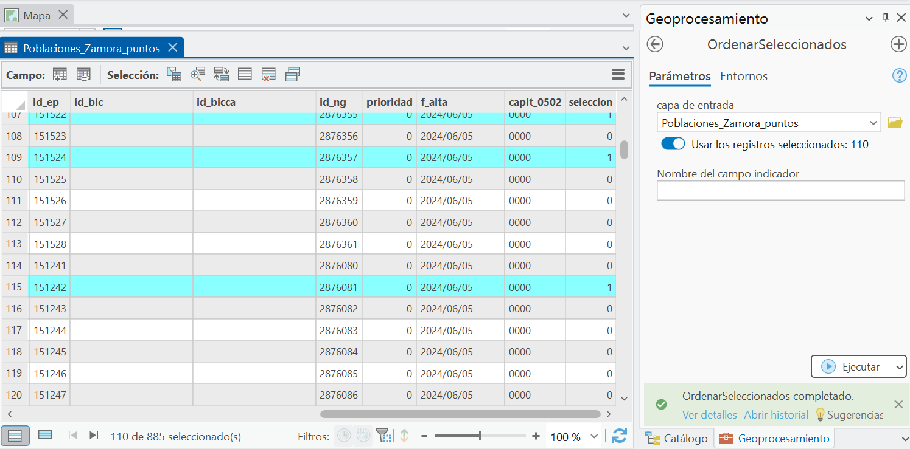
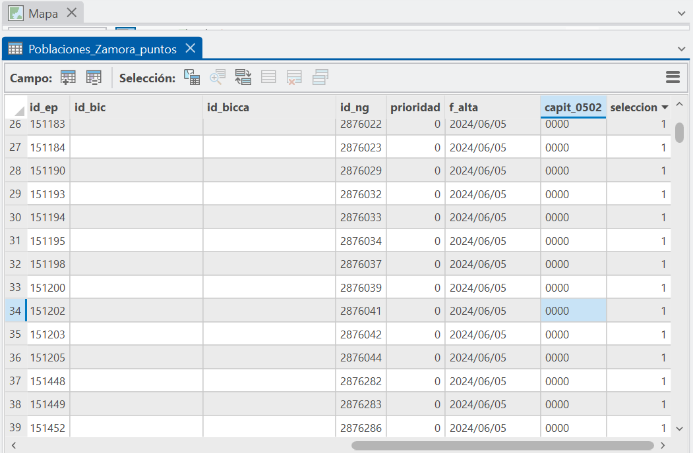
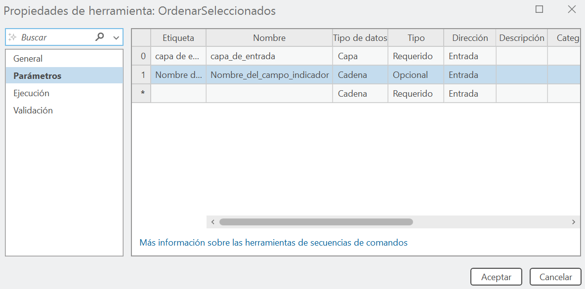

# Ordenar selección · herramienta ArcPy para ArcGIS Pro

Herramienta de secuencia de comandos (*script tool*) en Python/ArcPy que marca las entidades seleccionadas de una capa en un campo indicador (1 = seleccionada, 0 = no seleccionada). Ordenando ese campo, todas las entidades seleccionadas quedan juntas al principio de la tabla de atributos, listas para revisarlas, compararlas o exportarlas.

Ejercicio de la asignatura de Programación del **Máster en Tecnologías de la Información Geográfica (Universidad Complutense de Madrid)**.

## El problema

Cuando se seleccionan entidades en el mapa, en la tabla de atributos aparecen repartidas entre el resto de registros. Si la selección no responde a un orden simple (por ejemplo, municipios **entre** 202 y 1.000 habitantes), no basta con ordenar una columna para agruparlas. Además, la selección se pierde al hacer clic en otro sitio, mientras que el campo indicador queda guardado en la tabla.

## Cómo funciona

1. Lee la capa y el nombre del campo indicador (por defecto `seleccion`).
2. Obtiene los identificadores (OID) seleccionados mediante `arcpy.Describe(capa).FIDSet`.
3. Crea el campo como `SHORT` si no existe (`arcpy.AddField_management`).
4. Recorre la tabla con `arcpy.da.UpdateCursor` y escribe 1 o 0 comparando cada OID con la selección.
5. Informa en la ventana de geoprocesamiento del número de entidades marcadas.

El código completo, comentado, está en [`src/ordenar_seleccionados.py`](src/ordenar_seleccionados.py).

## Ejemplo de uso

Capa de localidades de la provincia de Zamora. Se seleccionan las de 202 a 1.000 habitantes y se ejecuta la herramienta:

Tras ordenar el campo `seleccion` de forma descendente, las 110 localidades seleccionadas quedan agrupadas al principio de la tabla:

## Instalación en ArcGIS Pro

1. En el panel **Catálogo** → **Cajas de herramientas** → **Nueva caja de herramientas (.atbx)**.
2. Clic derecho sobre la caja → **Nueva** → **Secuencia de comandos**.
3. En **General**, pon nombre y etiqueta (por ejemplo, `OrdenarSeleccionados`).
4. En **Parámetros**, define:

   | # | Etiqueta | Tipo de datos | Tipo | Dirección |
   |---|---|---|---|---|
   | 0 | Capa de entrada | Capa | Requerido | Entrada |
   | 1 | Nombre del campo indicador | Cadena | Opcional | Entrada |

5. En **Ejecución**, enlaza el archivo `src/ordenar_seleccionados.py`.
6. Al ejecutarla, deja activada la opción **Usar los registros seleccionados**.

## Compatibilidad y limitaciones

Funciona con shapefiles, clases de entidad de geodatabase, capas resultado de geoprocesos, capas importadas desde CSV/Excel y capas con `FID` en lugar de `OBJECTID`.

No funciona, o puede fallar, con:
- capas alojadas en servicios web (Feature Service, WFS, Portal);
- capas procedentes de uniones complejas, donde `FIDSet` puede no estar disponible;
- capas de consulta (Query Layer) y capas ráster.

La herramienta no borra el campo indicador: así la selección puede conservarse o ampliarse en ejecuciones posteriores. Si ya no se necesita, se elimina desde la tabla de atributos.

> ArcGIS Pro también permite ver solo los registros seleccionados desde la propia tabla. Esta herramienta es un ejercicio de automatización con ArcPy, y su aportación es dejar la selección **guardada como atributo**, lo que permite ordenarla, exportarla o combinarla con otros filtros.

## Requisitos

- ArcGIS Pro 3.x (Python 3 con `arcpy`).

## Autor

**Jacinto Domínguez Morales** · [LinkedIn](https://www.linkedin.com/in/jacinto-dom%C3%ADnguez-morales-41376b163/)
